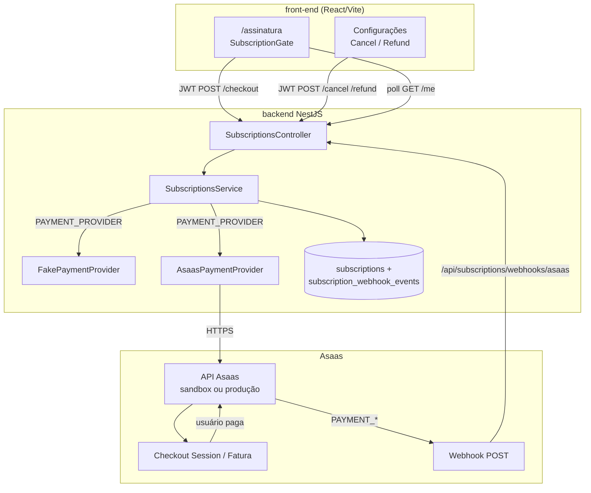
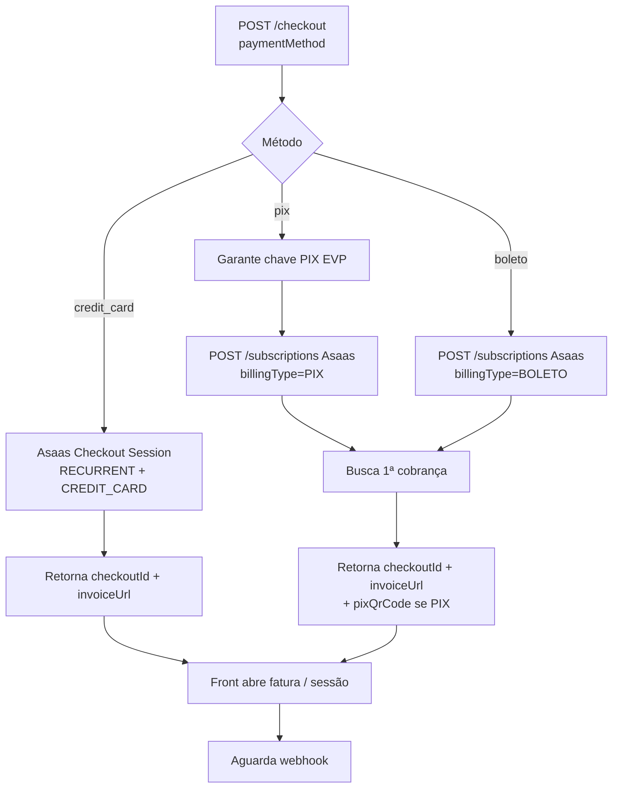
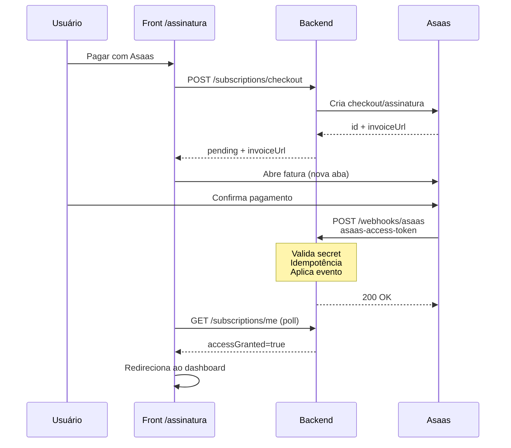
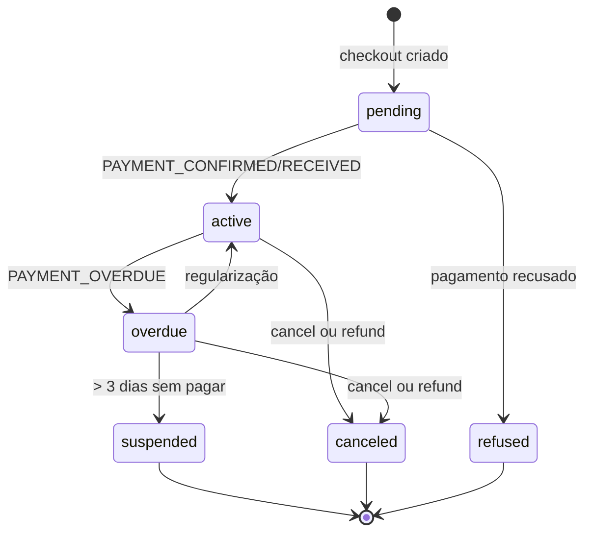
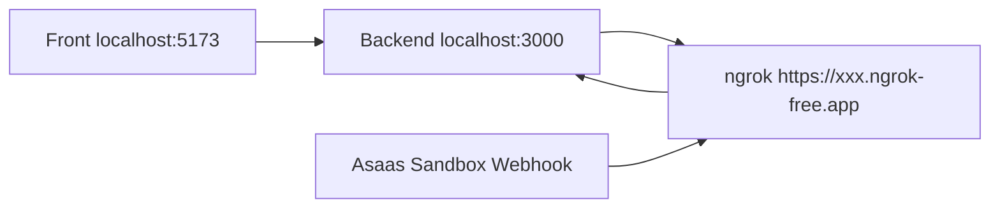

# Checkout de pagamento Asaas — Evolente

Documento de referência do fluxo de assinatura via **Asaas** no monorepo Evolente: regras de negócio, arquitetura, o que já está implementado, o que ficou fora de escopo e como operar (sandbox, webhook, testes locais).

| | |
|---|---|
| **Status do slice** | Slice 039 — **done** (código entregue) |
| **Gateway** | Asaas |
| **Stack web** | `front-end` (React/Vite) |
| **Mobile** | Gate/aviso apenas; **sem checkout no app** nesta fase |
| **Contrato** | `contracts/openapi.yaml` (paths `/subscriptions/*`) |
| **Slice** | `tasks/slices/039-gateway-asaas-assinatura.md` |

---

## 1. Objetivo

Substituir o provider fake de pagamento por integração real com Asaas, permitindo que **profissional** e **responsável** assinem planos mensais (cartão, PIX ou boleto) e só tenham acesso completo após confirmação do pagamento.

O **master** é isento: não passa por checkout e já possui `accessGranted=true`.

---

## 2. Decisões de produto (confirmadas)

| Tema | Decisão |
|---|---|
| Gateway | Asaas |
| Plano profissional | **R$ 79,00**/mês (`7900` centavos) |
| Plano responsável | **R$ 49,00**/mês (`4900` centavos) |
| Periodicidade | Mensal |
| Meios | Cartão, PIX, boleto |
| Moeda | BRL |
| Master | Isento |
| Assinatura | Por **conta** (não por filho) |
| Checkout | **Somente na web** |
| Mobile | Consome `accessGranted`; orienta regularizar na web |

Fontes: `requirements/001-escopo-produto.md` §8 e `requirements/002-regras-de-negocio.md` §5.

---

## 3. Ciclo de estados da assinatura

```text
PENDING → ACTIVE → OVERDUE → SUSPENDED → CANCELED
```

Caminhos laterais:

- `PENDING` → `refused` (pagamento recusado no checkout)
- `ACTIVE` / `OVERDUE` → `CANCELED` (cancelamento ou reembolso)
- `OVERDUE` → `ACTIVE` (regularização dentro da carência)

| Status | Significado | `accessGranted` |
|---|---|---|
| `pending` | Checkout iniciado; aguarda confirmação | `false` |
| `active` | Pagamento confirmado; assinatura em dia | `true` |
| `overdue` | Atraso dentro da carência de **3 dias** | `true` |
| `suspended` | Carência esgotada; conta inativada | `false` |
| `canceled` | Cancelamento ou reembolso | `false` |
| `refused` | Pagamento recusado | `false` |

### Regras de ciclo

| Evento | Comportamento |
|---|---|
| Pagamento confirmado (webhook) | → `active`, libera acesso, registra `firstPaidAt` / janela de reembolso |
| Atraso | → `overdue`; após **3 dias** sem regularizar → `suspended` (inativa conta) |
| Cancelamento | → `canceled` + **bloqueio imediato** |
| Reembolso | Só até **3 dias de uso** após o 1º pagamento; → `canceled` + bloqueio imediato |
| Inadimplência prolongada | **Não** — sem estado além de overdue (3 dias) + suspended |

---

## 4. Arquitetura (visão geral)



### Papéis por camada

| Camada | Responsabilidade |
|---|---|
| **Front** | Gate de assinatura, escolha do meio, abrir `invoiceUrl`, poll/verificar pagamento, cancel/refund em Configurações |
| **Backend** | Orquestra provider, persiste assinatura, aplica webhook, controla `accessGranted` |
| **Asaas** | Cobrança/assinatura, UI de pagamento, eventos de webhook |
| **Mobile** | Se `accessGranted=false`, mostra aviso e manda regularizar na web |

---

## 5. O que já está implementado

O Slice 039 e tasks relacionadas estão **done**. Resumo por área:

### 5.1 Contrato OpenAPI (Task 419)

- Enum de status expandido (`pending`, `active`, `overdue`, `suspended`, `canceled`, `refused`)
- Paths: checkout, confirm (fake), cancel, refund, `webhooks/asaas`, `webhooks/fake`
- Meios e planos documentados no contrato

### 5.2 Backend — provider Asaas (Task 420)

Arquivo principal: `backend/src/modules/subscriptions/providers/asaas-payment.provider.ts`

| Meio | Estratégia na API Asaas |
|---|---|
| **Cartão** | Checkout Session **RECURRENT** / mensal (`CREDIT_CARD` apenas) |
| **PIX** | Assinatura clássica `POST /subscriptions` + 1ª cobrança + QR (`/payments/{id}/pixQrCode`); tenta garantir chave PIX EVP |
| **Boleto** | Assinatura clássica `POST /subscriptions` + URL da 1ª cobrança / boleto |

Motivo da divisão: Checkout Session do Asaas **não aceita boleto**; PIX no Checkout Session só em cobrança avulsa — por isso PIX/boleto usam assinatura clássica.

Outros pontos:

- DI via `PAYMENT_PROVIDER=asaas|fake`
- `/subscriptions/confirm` e webhook fake **bloqueados** quando provider = asaas
- Callbacks `successUrl` / `cancelUrl` exigem **HTTPS** (`APP_PUBLIC_URL`)
- PIX/boleto exigem **CPF** (responsável) ou **CNPJ** (profissional) no perfil
- `externalReference` no formato `userId:audience`

### 5.3 Backend — webhook e ciclo (Task 421)

- `POST /api/subscriptions/webhooks/asaas`
- Header: `asaas-access-token` = `PAYMENT_GATEWAY_WEBHOOK_SECRET`
- Idempotência via tabela `subscription_webhook_events`
- Eventos tratados:

| Evento Asaas | Efeito local |
|---|---|
| `PAYMENT_CONFIRMED` | → `active` + libera acesso |
| `PAYMENT_RECEIVED` | → `active` + libera acesso |
| `PAYMENT_ANTICIPATED` | → `active` + libera acesso |
| `PAYMENT_OVERDUE` | → `overdue`; pode suspender após 3 dias |
| `PAYMENT_REFUNDED` | → `canceled` + bloqueia |
| `PAYMENT_DELETED` | → `canceled` + bloqueia |

Matching da assinatura local: tenta `checkoutSession`, `subscription`, `payment.id` e `externalReference`.

### 5.4 Backend — cancel / refund / supersede (Tasks 421, 487)

- Cancel e refund na API, com estorno no Asaas quando aplicável
- Hardening: se falhar o cancelamento remoto de um checkout pendente ao criar outro, **não** marca o pendente local como cancelado (evita divergência)

### 5.5 Front-end — gate e gestão (Tasks 422, 423, 425, 558, 597, 598)

Rota: `/assinatura` (`SubscriptionGate`)

Etapas principais:

1. Pós-cadastro → autenticar (“Entrar e continuar”)
2. Escolher meio (cartão / PIX / boleto) → “Pagar com Asaas”
3. Aguardar confirmação (poll ~4s + botão “Já paguei — verificar agora”)
4. Acesso liberado → dashboard

Também:

- Card de cancelamento/reembolso em Configurações (web)
- Wizard do responsável redireciona ao pagamento após cadastro
- Layout do gate refinado (listas, painéis, feedback do botão verificar)

### 5.6 Mobile (Task 423)

- Sem checkout Asaas no app
- Aviso quando assinatura inativa / `accessGranted=false`, orientando regularizar na web

### 5.7 Admin

- Página de planos com valores oficiais e gateway Asaas (Task 424)
- Listagem/status de assinaturas no admin existente (sem portal Asaas avançado)

---

## 6. Fluxogramas

### 6.1 Jornada do usuário (cadastro → acesso)

```mermaid
flowchart TD
  A[Cadastro web<br/>profissional ou responsável] --> B{Master?}
  B -->|sim| Z[accessGranted=true<br/>sem checkout]
  B -->|não| C[/assinatura]
  C --> D{Autenticado?}
  D -->|não| E[Login no gate]
  E --> D
  D -->|sim| F{accessGranted?}
  F -->|sim| G[Dashboard / área liberada]
  F -->|não| H[Escolher meio de pagamento]
  H --> I[POST /subscriptions/checkout]
  I --> J[Abrir invoiceUrl Asaas]
  J --> K[Usuário paga no Asaas]
  K --> L[Webhook PAYMENT_CONFIRMED/RECEIVED]
  L --> M[Backend: status=active<br/>accessGranted=true]
  M --> N[Front: poll ou Já paguei]
  N --> G
```

### 6.2 Checkout por meio de pagamento



### 6.3 Webhook Asaas → liberação



### 6.4 Atraso, cancelamento e reembolso



### 6.5 Teste local com ngrok (operacional)



> Asaas **não** alcança `localhost`. Sem URL pública (ngrok/deploy), o pagamento confirma no Asaas, mas o app permanece `pending`.

---

## 7. APIs internas (resumo)

Prefixo global: `/api`

| Método | Path | Auth | Uso |
|---|---|---|---|
| `GET` | `/subscriptions/me` | JWT | Status + `accessGranted` |
| `GET` | `/subscriptions/access` | JWT + gate | Probe 200/403 |
| `POST` | `/subscriptions/checkout` | JWT | Inicia checkout Asaas/fake |
| `POST` | `/subscriptions/confirm` | JWT | **Só** `PAYMENT_PROVIDER=fake` |
| `POST` | `/subscriptions/cancel` | JWT | Cancela + bloqueia |
| `POST` | `/subscriptions/refund` | JWT | Reembolsa (janela 3 dias) |
| `POST` | `/subscriptions/webhooks/asaas` | Header `asaas-access-token` | Confirma ciclo Asaas |
| `POST` | `/subscriptions/webhooks/fake` | — | **Só** provider fake |

Detalhes: `contracts/openapi.yaml`.

---

## 8. Variáveis de ambiente (backend)

| Variável | Função |
|---|---|
| `PAYMENT_PROVIDER` | `asaas` ou `fake` |
| `ASAAS_ENV` | `sandbox` (default) ou `production` |
| `PAYMENT_GATEWAY_API_KEY` | API Key Asaas (`$aact_hmlg_…` sandbox / `$aact_prod_…` produção) |
| `PAYMENT_GATEWAY_WEBHOOK_SECRET` | Token do webhook (= header `asaas-access-token`) |
| `PAYMENT_GATEWAY_BASE_URL` | Opcional; override da base API |
| `PAYMENT_PROFESSIONAL_AMOUNT_CENTS` | Default `7900` |
| `PAYMENT_GUARDIAN_AMOUNT_CENTS` | Default `4900` |
| `PAYMENT_CURRENCY` | Default `BRL` |
| `APP_PUBLIC_URL` | URL **HTTPS** do front (callbacks do Checkout Session) |

URLs Asaas usadas pelo código:

| Ambiente | API | Checkout Session UI |
|---|---|---|
| Sandbox | `https://api-sandbox.asaas.com/v3` | `https://sandbox.asaas.com/checkoutSession/show` |
| Produção | `https://api.asaas.com/v3` | `https://asaas.com/checkoutSession/show` |

---

## 9. Configuração no painel Asaas

### Sandbox

1. Conta em [https://sandbox.asaas.com](https://sandbox.asaas.com) (independente da produção)
2. **Integrações → API Key** → colar em `PAYMENT_GATEWAY_API_KEY`
3. **Integrações → Webhooks → Criar**
   - URL: `https://<host-público>/api/subscriptions/webhooks/asaas`
   - Token = `PAYMENT_GATEWAY_WEBHOOK_SECRET`
   - Webhook ativo + **fila de sincronização ativada**
   - Eventos mínimos (Cobranças):  
     `PAYMENT_RECEIVED`, `PAYMENT_CONFIRMED`, `PAYMENT_ANTICIPATED`,  
     `PAYMENT_OVERDUE`, `PAYMENT_REFUNDED`, `PAYMENT_DELETED`
   - Eventos extras (já tratados no backend):  
     `PAYMENT_CREATED` (vincula `lastPaymentId`),  
     `PAYMENT_REFUND_IN_PROGRESS` (acompanha até `PAYMENT_REFUNDED`),  
     `PAYMENT_CREDIT_CARD_CAPTURE_REFUSED` → `refused` + bloqueia acesso
   - Eventos de Checkout (cartão / Checkout Session):  
     `CHECKOUT_PAID` (recomendado também `CHECKOUT_EXPIRED`, `CHECKOUT_CANCELED`)
4. PIX: ideal cadastrar chave (**Pix → Minhas chaves**); o backend também tenta criar EVP

### Produção

- Conta/produção separada, chave `$aact_prod_…`, `ASAAS_ENV=production`
- Mesma URL de webhook apontando para o backend de produção
- Não misturar chave sandbox com URL de produção (e vice-versa)

### Fila interrompida

Após **15 falhas** consecutivas o Asaas pausa a fila (“Interrompido”). Corrija a URL/endpoint, reative a fila (`interrupted: false`) ou recrie o webhook. Logs: **Integrações → Logs de Webhooks**.

---

## 10. Teste local ponta a ponta

1. Backend: `cd backend && npm run start:dev` (porta **3000**)
2. Front: `cd front-end && npm run dev`
3. Expor API: `ngrok http 3000`
4. Atualizar webhook Asaas para `https://<ngrok>/api/subscriptions/webhooks/asaas`
5. `.env` com `PAYMENT_PROVIDER=asaas`, chave sandbox e secret alinhado ao token do webhook
6. `APP_PUBLIC_URL` deve ser HTTPS válido para cartão (callbacks). Em dev estrito local HTTP o Checkout Session de cartão pode falhar — use URL pública HTTPS do front ou ambiente já publicado
7. Fluxo: cadastrar/logar → `/assinatura` → pagar no sandbox → webhook 2xx → “Já paguei” ou poll libera acesso

Simular pagamento PIX/boleto no sandbox: abrir a cobrança no painel Asaas → **Simular pagamento**.

---

## 11. O que **não** será / não está no escopo atual

Definido no Slice 039 e requirements:

| Item | Status |
|---|---|
| Checkout Asaas no **mobile** | Fora de escopo nesta fase |
| Planos **anuais** | Fora |
| Notificações **push** de cobrança | Fora (provedor push ainda a definir) |
| Portal Asaas avançado para o master | Fora (além do status no admin) |
| Migração em massa de assinaturas **fake** históricas | Caso a caso, não automatizado |
| Deploy/ops da URL `evolente-api.fasters.app` | Operacional (humano); se retornar 404, webhook não confirma |

### Pendências operacionais típicas (não são “falta de código” do slice)

- Webhook apontando para host público saudável (ngrok em local ou API deployada)
- Secret do painel = `.env`
- Fila Asaas ativa (não interrompida)
- Perfis com CPF/CNPJ para PIX/boleto

---

## 12. Mapa de arquivos úteis

| Área | Caminho |
|---|---|
| Provider Asaas | `backend/src/modules/subscriptions/providers/asaas-payment.provider.ts` |
| Service / webhook | `backend/src/modules/subscriptions/subscriptions.service.ts` |
| Controller | `backend/src/modules/subscriptions/subscriptions.controller.ts` |
| Entity | `backend/src/modules/subscriptions/entities/subscription.entity.ts` |
| Gate web | `front-end/src/pages/Auth/SubscriptionGate/` |
| Client API front | `front-end/src/services/subscriptions/subscriptionService.ts` |
| Cancel/refund UI | `front-end/src/pages/Main/Settings/SubscriptionManagementCard.tsx` |
| Contrato | `contracts/openapi.yaml` |
| Slice | `tasks/slices/039-gateway-asaas-assinatura.md` |
| Requirements | `requirements/001-escopo-produto.md`, `002-regras-de-negocio.md` |

### Tasks do slice (todas done)

- 419 contrato · 420 provider · 421 webhook/ciclo · 422 tela checkout · 423 cancel/refund + gate mobile  
- 424 planos master · 425 confirmação/valores · 487 supersede · 597/598 polish UI do gate  

---

## 13. Checklist rápido de homologação

- [ ] `PAYMENT_PROVIDER=asaas` e chave sandbox no `.env`
- [ ] Webhook ativo, fila ligada, token = secret
- [ ] URL do webhook alcançável (2xx nos logs Asaas)
- [ ] Cartão: checkout abre e `PAYMENT_CONFIRMED` libera acesso
- [ ] PIX: exige documento; simular pagamento; libera acesso
- [ ] Boleto: idem
- [ ] Cancelamento bloqueia na hora
- [ ] Reembolso dentro de 3 dias ok; fora da janela recusado/oculto na UI
- [ ] Master nunca vê checkout
- [ ] Mobile só avisa quando sem acesso

---

## 14. Referências externas

- [Sandbox Asaas](https://docs.asaas.com/docs/sandbox)
- [Webhooks](https://docs.asaas.com/docs/receba-eventos-do-asaas-no-seu-endpoint-de-webhook)
- [Fila interrompida](https://docs.asaas.com/docs/como-reativar-fila-interrompida)
- [Cobranças PIX](https://docs.asaas.com/docs/cobrancas-via-pix)

---

*Documento gerado a partir do código e do backlog do repositório Evolente. Em caso de divergência, prevalecem `contracts/openapi.yaml` e `requirements/`.*
